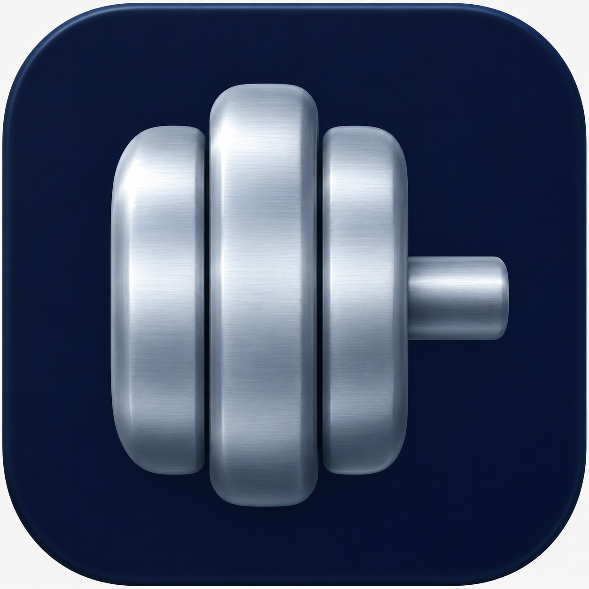

# Forja — approved logo assets

Metallic loaded barbell end on midnight navy, approved by the owner on 2026-11-16.
See [decision 0001](../../decisions/0001-metallic-barbell-logo.md). Codex creates the artwork;
Claude Code integrates these files without redrawing or replacing the metallic finish with CSS.

| File | Use |
|------|-----|
| `approved-preview.png` | Exact approved image, 1254 × 1254, with rounded tile/beveled edge and off-white corners. Design reference or ordinary image presentation; not an OS icon. |
| `master.png` | Production source, 1254 × 1254. Background-only packaging edit extending navy to all edges without a baked-in corner mask. |
| `app-icon-1024.png` | Large image placement or high-resolution handoff |
| `app-icon-512.png`, `app-icon-192.png` | App image and future home-screen icon exports |
| `app-icon-180.png` | Apple touch icon |
| `favicon-16.png`, `favicon-32.png`, `favicon-48.png`, `favicon-64.png` | Browser icon exports |
| `favicon.ico` | PNG-backed ICO containing 16, 32, 48 and 64 px images |
| `export-review.png` | Visual QA sheet, not an application asset |

Use opaque production PNGs for OS icons and let the platform apply its own corner mask. For an in-app
rounded tile, use a production PNG with the component's corner radius; avoid double masking the preview.
Do not stretch, recolor, rotate, add text over the symbol, or reconstruct it from stock shapes.
Palette anchors are navy `#101B35` and silver `#DDE7F5`; the master includes deliberate lighting variation.
This is raster artwork, not an SVG or transparent symbol. The previous anvil, wordmarks and vector files
were rejected and removed from this unmerged proposal. No replacement wordmark is approved.

Choose an export at least as large as the rendered image times the display pixel ratio. The smallest
favicons retain the silhouette while the metallic texture naturally softens. No maskable-PWA safe-area
claim is made; review that separately if installation is implemented in M5.

Claude Code's integration belongs in `apps/web`: copy required production files, wire favicon and touch
metadata, and supply accessible labels through next-intl in English and Spanish. Hide decorative copies
beside visible branding. Linked logos need destination labels and a minimum 44 × 44 px touch area.
None of the image files contain interface text. Existing font styling can render the app name separately.

## Provenance and reproduction

Created with the built-in imagegen tool, then exported with the repository's existing Sharp library.
Approval prompt: three substantial rounded vertical plates, middle tallest, short right-facing sleeve,
soft brushed/satin silver metal with restrained directional highlights, on midnight navy; no text.
Production edit prompt: preserve the approved subject and finish; remove only the tile border and white
outside corners, extending the navy background to all four square edges. No redesign.
All derived icons are Lanczos3 downsamples of `master.png`; none exceed the source resolution.

Validation: visual review of the approved preview, full-bleed master and actual-size export sheet;
verified opaque square PNG dimensions and decoded each ICO entry to confirm 16/32/48/64 px payloads.
Application integration still needs its own visual and accessibility review.
