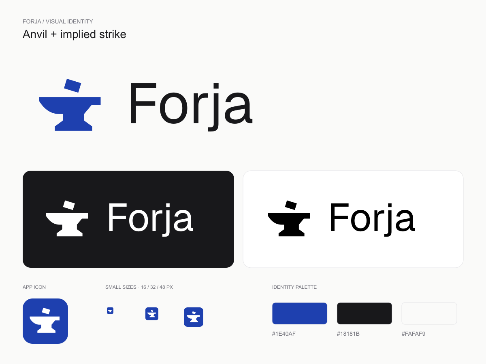

# Forja logo assets

Original vector artwork by Codex for Forja, following [decision 0001](../../decisions/0001-logo-direction.md).
Codex owns visual design and artwork; Claude Code integrates the supplied assets into the app.

| Asset | Use |
|-------|-----|
| `symbol-blue.svg` | Canonical 256 × 256 transparent master, deep blue on light surfaces |
| `symbol-black.svg`, `symbol-white.svg` | Transparent monochrome masters; white for dark surfaces |
| `wordmark-blue.svg` | 415 × 160 horizontal arrangement: blue symbol and charcoal name |
| `wordmark-black.svg`, `wordmark-white.svg` | Transparent monochrome arrangements |
| `favicon.svg` | Blue tile with the simplified white anvil for small browser rendering |
| `favicon.ico` | Multi-resolution PNG-backed ICO: 16, 32 and 48 px |
| `favicon-16.png`, `favicon-32.png`, `favicon-48.png` | Browser raster variants; 16 px omits the strike |
| `app-icon.svg` | Square opaque blue master with full white symbol; no baked-in corner mask |
| `app-icon-180.png` | Apple touch icon |
| `app-icon-192.png`, `app-icon-512.png` | Future home-screen/PWA assets; not a request to implement PWA behavior now |
| `preview.svg`, `preview.png` | Review sheet, not an application asset |

The small angled block suggests a strike above the broad anvil. Open space keeps the two shapes separate.
All production SVGs contain only paths/groups/rectangles: no text, embedded fonts, external URLs or scripts.
Wordmark lettering was outlined from Geist Regular already bundled with Next.js in this repository;
no font binary is redistributed. Use the wordmark as delivered rather than retyping its name.

Keep the SVG view boxes and aspect ratios. Minimum symbol box: 32 px for the full design; use the
simplified favicon at 16 px. Minimum horizontal wordmark width: 104 px. Leave at least 24 master units
of space outside the symbol view box (about one tenth of the displayed box) between the logo and other
content. Do not stretch, rotate, add effects or alter the separation between the shapes.

Use blue `#1E40AF` on off-white `#FAFAF9` or white; charcoal is `#18181B`. Use the white version on
charcoal or blue. Black and white versions use literal `#000000` and `#FFFFFF`.
Home-screen icon content stays within the central circular safe area of radius 40% of the canvas width;
let the operating system apply its own corner mask. The preview shows one possible rounded treatment.

Claude Code: copy production assets into `apps/web`, wire metadata/icons, and provide translated
accessible labels in English and Spanish. Hide decorative duplicates beside visible branding. Linked
logos need destination labels and at least a 44 × 44 px touch area. Do not expose English labels from
this review sheet as interface text. The assets themselves contain no accessibility text; the embedding
component supplies it through next-intl.

Validation: rendered all SVG variants, checked the review sheet visually, verified PNG dimensions,
and checked ICO entries and SVG structure. Recheck actual app integration on light/dark surfaces.
