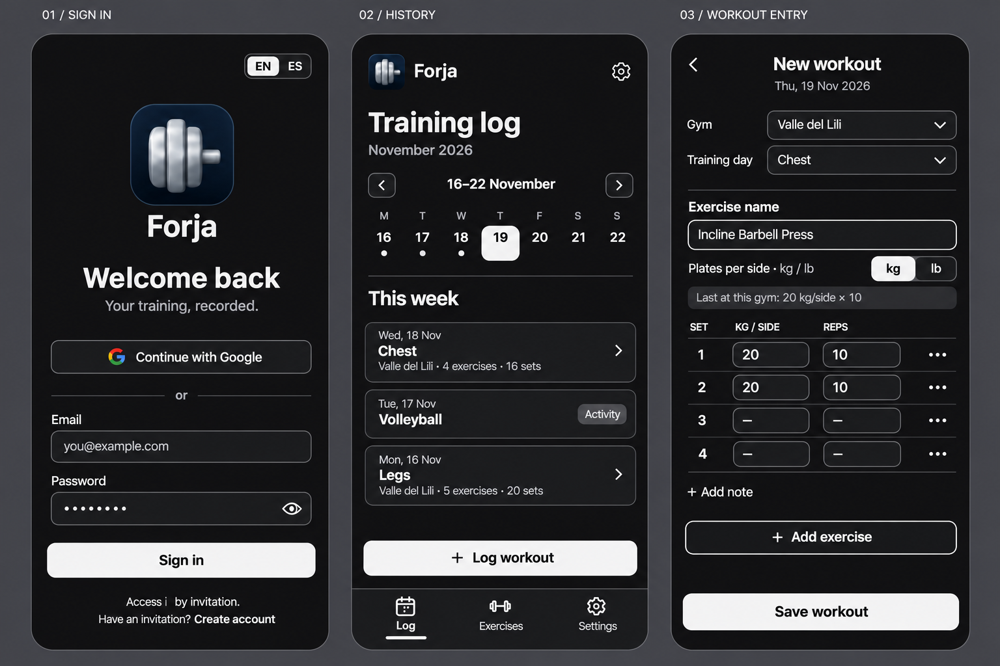
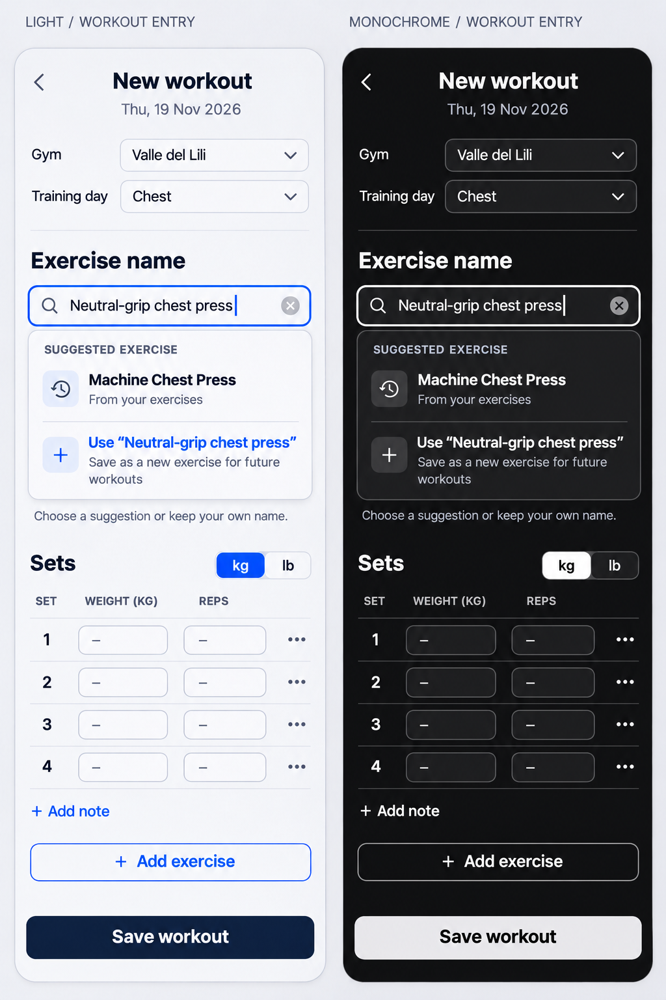

# M3 page-design handoff

First visual direction approved on 2026-11-19: **light with blue accents + monochrome dark**, and editable
exercise names with optional suggestions and reusable custom names. See
[decision 0004](../../decisions/0004-m3-page-designs.md).

| File | Purpose |
|------|---------|
| `overview-light.png` | Sign-in, history and basic workout-entry hierarchy in the light palette |
| `overview-dark.png` | The same overview using charcoal/white; supersedes the earlier navy UI |
| `exercise-autocomplete.png` | Expanded editable-name interaction in both approved themes; takes precedence over overview entry details |

## Read these as designs, not screenshots to embed

Claude Code implements semantic components from these references, not full-page images. Use the exact
existing logo assets from `../logo/`, not a regenerated logo cropped from a screen mockup. Slight generated
variation in texture, logo pixels, text and spacing is not a new design instruction. The written record and
constraints take precedence. Dates, sessions and numbers are fictional examples, not data to seed.

The overview shows two manually entered set rows; it does not imply pre-fill. The autocomplete reference
shows a new name before selection with empty set fields; it does not imply history exists for that name.
The date is editable despite its title-like appearance. History lists the displayed week; its highlighted
day is orientation, not a claim the whole list is filtered to that day. Dots indicate actual recorded events.

## Palette and geometry

Semantic tokens pair roles across themes rather than scattering color literals through components.
These values specify intended flat colors; generated shading in PNGs is not an instruction to add gradients.

| Role | Light | Dark |
|------|-------|------|
| Page | `#F7F8FA` | `#111113` |
| Raised/input surface | `#FFFFFF` | `#1C1C1F` |
| Main text | `#101B35` | `#F4F4F5` |
| Secondary text | `#526078` | `#B4B4BC` |
| Decorative separator | `#CBD2DE` | `#45454C` |
| Input boundary | `#7E8B9D` | `#777780` |
| Primary action fill | `#101B35` | `#E8E8EC` |
| Primary action label | `#FFFFFF` | `#111113` |
| Selected/action accent | `#2155D9` | `#F4F4F5` |
| Text on accent | `#FFFFFF` | `#111113` |
| Focus indicator | `#2155D9` | `#F4F4F5` |

Use stronger input-boundary tokens for essential control edges; low-contrast decorative separators alone
must not be the only way to locate an input. Meaning must not depend solely on color. The navy logo and
Google provider icon retain their own colors even in the monochrome interface. Error/success states must
also use text/icons; their detailed visual treatment is a follow-up, not invented from these PNGs.

Use Geist, tabular numerals for set entry, a base 16 px input/body size, a simple 8 px spacing rhythm,
16–24 px horizontal mobile padding and approximately 12–16 px control/card radii. Set rows and compact
icons must still have a minimum 44 × 44 px hit area; artwork size is not hit-area size.

The tall autocomplete image is an expanded scroll reference, **not one phone viewport**. At 390 px width,
keep the real text/input sizes, collapse suggestions on selection, and let content scroll. A pinned Save
workout action needs bottom padding so it never covers the final row and must work with the keyboard.
For narrow/desktop layouts, preserve the hierarchy and usable form width rather than stretching fields
edge-to-edge across a monitor. Detailed breakpoint, theme-switcher placement and persistence decisions
are not supplied by these first mockups.

## Interaction details

- Sign-in: invitation-gated Google or password flow, bilingual switch, normal app-name text. Create account
  copy is an invite-only route, not public registration. Auth failure, loading and account-creation forms
  still need follow-up visual states.
- History: previous/next week, actual session/activity list, Log workout action. Keep notes-derived reference
  weights out of history. Saved-record detail and activity-entry views remain to be designed.
- Entry: select gym/training day, type/select exercise, one row per set, optional notes, add another exercise,
  then Save workout. The name is not a static heading. Search may suggest similar names, but a nonmatching
  name remains usable. Exact normalized matches reuse the existing identity per rule 12.
- Show source-aware last/reference values separately; no values are auto-filled in M3 by this design.
- Custom exercise setup must collect the existing creation contract's metadata, including load mode; its
  follow-up UI is not shown. Never infer per-side vs total solely from a typed name.
- Per-row ellipsis opens set details such as To failure; selecting a marker does not mean the set or workout
  has been persisted. The compact unit selector must still support each set's own unit. On mixed-unit
  rows, show the unit beside each value and avoid a misleading global KG header.
- Translate all interface and accessible text through next-intl in both languages. Custom exercise names
  remain as typed; do not translate them. Existing identities/history are never silently renamed.

## Provenance and validation

Created with built-in imagegen for visual review. The light and monochrome entry comparison is the
owner-reviewed theme reference. The aligned overview boards reproduce that palette for sign-in/history.
Prompts: calm mobile-first sign-in/history/set-entry layouts using the existing logo; light off-white/navy/
blue; dark charcoal/gray/off-white; optional autocomplete with an explicit Use-name action. Theme edits
preserve layout and data while changing palette. No API fallback or generated UI code was used.

Visually reviewed all three boards and verified the PNGs decode. Palette contrast is calculated separately
from the generated pixels; rendered component contrast, focus, actual target sizes, Spanish text wrapping,
keyboard behavior and save/error interactions must be checked during implementation. These static boards
do not demonstrate working interactions or certify accessibility. Remaining design follow-ups are listed
in decision 0004.

Calculated intended-token contrast: light main text 16.06:1, light secondary 6.36:1, blue on white
6.24:1; dark main text 17.16:1, dark secondary 8.25:1, dark action label 15.43:1. Input boundaries
are stronger than decorative separators; these ratios describe specified colors, not generated PNG pixels.
