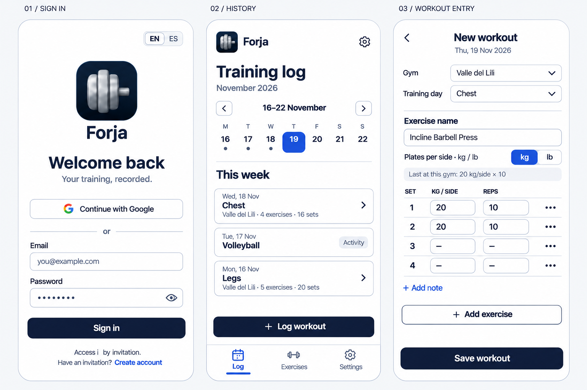
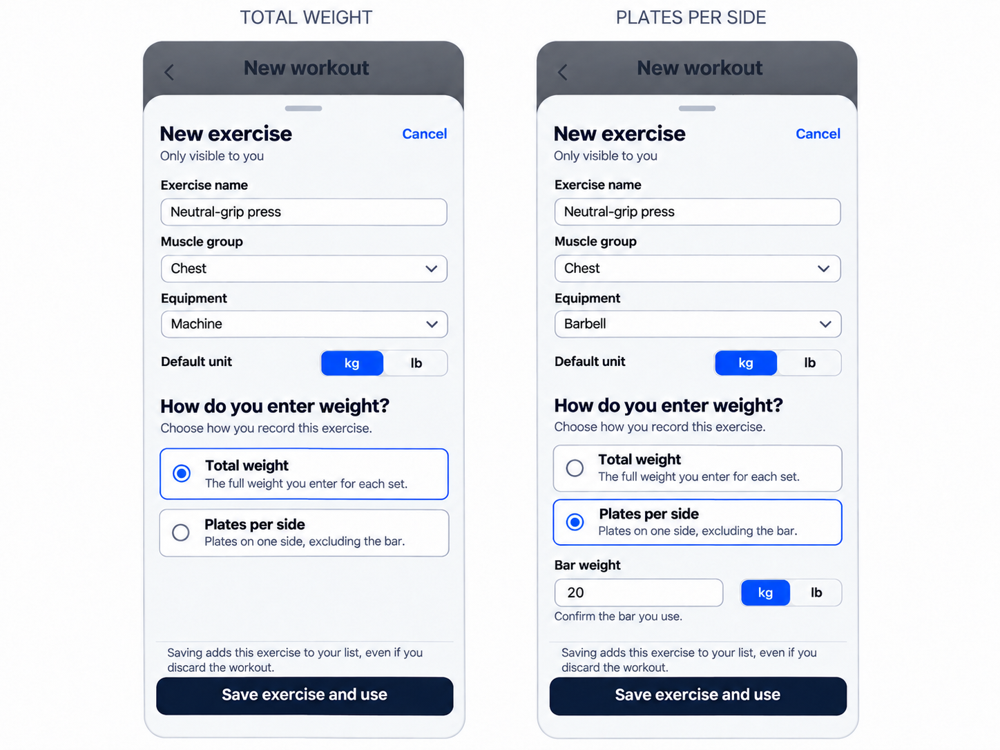
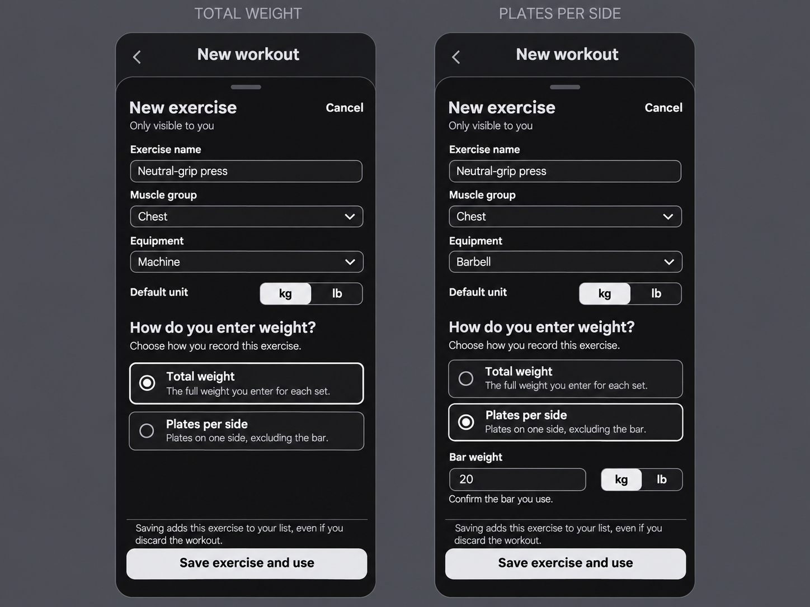
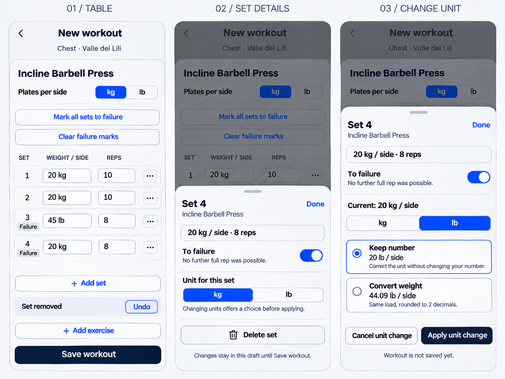
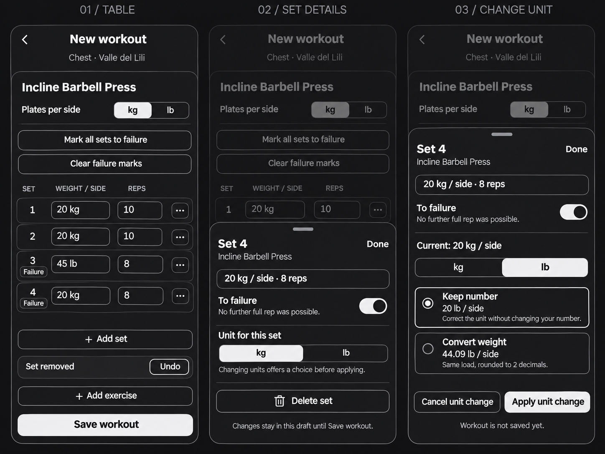

# M3 page-design handoff

First visual direction approved on 2026-11-19: **light with blue accents + monochrome dark**, and editable
exercise names with optional suggestions and reusable custom names. See
[decision 0004](../../decisions/0004-m3-page-designs.md).

| File | Purpose |
|------|---------|
| `overview-light.png` | Sign-in, history and basic workout-entry hierarchy in the light palette |
| `overview-dark.png` | The same overview using charcoal/white; supersedes the earlier navy UI |
| `exercise-autocomplete.png` | Expanded editable-name interaction in both approved themes; takes precedence over overview entry details |
| `custom-exercise-light.png` | Tall custom-exercise sheet: total-weight and per-side examples, light theme |
| `custom-exercise-dark.png` | Same two setup states in the approved monochrome theme |
| `set-details-light.png` | Table with failure badges/Undo, set-details sheet and explicit unit-choice preview, light theme |
| `set-details-dark.png` | Same three set-detail states in the approved monochrome theme |

## Read these as designs, not screenshots to embed

Claude Code implements semantic components from these references, not full-page images. Use the exact
existing logo assets from `../logo/`, not a regenerated logo cropped from a screen mockup. Slight generated
variation in texture, logo pixels, text and spacing is not a new design instruction. The written record and
constraints take precedence. Dates, sessions and numbers are fictional examples, not data to seed.

The overview shows two manually entered set rows; it does not imply pre-fill. The autocomplete reference
shows a new name before selection with empty set fields; it does not imply history exists for that name.
The date is editable despite its title-like appearance. History lists the displayed week; its highlighted
day is orientation, not a claim the whole list is filtered to that day. Dots indicate actual recorded events.

## Palette and geometry

Semantic tokens pair roles across themes rather than scattering color literals through components.
These values specify intended flat colors; generated shading in PNGs is not an instruction to add gradients.

| Role | Light | Dark |
|------|-------|------|
| Page | `#F7F8FA` | `#111113` |
| Raised/input surface | `#FFFFFF` | `#1C1C1F` |
| Main text | `#101B35` | `#F4F4F5` |
| Secondary text | `#526078` | `#B4B4BC` |
| Decorative separator | `#CBD2DE` | `#45454C` |
| Input boundary | `#7E8B9D` | `#777780` |
| Primary action fill | `#101B35` | `#E8E8EC` |
| Primary action label | `#FFFFFF` | `#111113` |
| Selected/action accent | `#2155D9` | `#F4F4F5` |
| Text on accent | `#FFFFFF` | `#111113` |
| Focus indicator | `#2155D9` | `#F4F4F5` |

Use stronger input-boundary tokens for essential control edges; low-contrast decorative separators alone
must not be the only way to locate an input. Meaning must not depend solely on color. The navy logo and
Google provider icon retain their own colors even in the monochrome interface. Error/success states must
also use text/icons; their detailed visual treatment is a follow-up, not invented from these PNGs.

Use Geist, tabular numerals for set entry, a base 16 px input/body size, a simple 8 px spacing rhythm,
16–24 px horizontal mobile padding and approximately 12–16 px control/card radii. Set rows and compact
icons must still have a minimum 44 × 44 px hit area; artwork size is not hit-area size.

The tall autocomplete image is an expanded scroll reference, **not one phone viewport**. At 390 px width,
keep the real text/input sizes, collapse suggestions on selection, and let content scroll. A pinned Save
workout action needs bottom padding so it never covers the final row and must work with the keyboard.
For narrow/desktop layouts, preserve the hierarchy and usable form width rather than stretching fields
edge-to-edge across a monitor. Detailed breakpoint, theme-switcher placement and persistence decisions
are not supplied by these first mockups.

## Interaction details

- Sign-in: invitation-gated Google or password flow, bilingual switch, normal app-name text. Create account
  copy is an invite-only route, not public registration. Auth failure, loading and account-creation forms
  still need follow-up visual states.
- History: previous/next week, actual session/activity list, Log workout action. Keep notes-derived reference
  weights out of history. Saved-record detail and activity-entry views remain to be designed.
- Entry: select gym/training day, type/select exercise, one row per set, optional notes, add another exercise,
  then Save workout. The name is not a static heading. Search may suggest similar names, but a nonmatching
  name remains usable. Exact normalized matches reuse the existing identity per rule 12.
- Show source-aware last/reference values separately; no values are auto-filled in M3 by this design.
- Custom exercise setup now follows the sheet below and the 2026-11-21 update in decision 0004. It
  collects all creation metadata explicitly and saves the reusable exercise before the workout.
- Per-row ellipsis opens set details such as To failure; selecting a marker does not mean the set or workout
  has been persisted. The compact unit selector must still support each set's own unit. On mixed-unit
  rows, show the unit beside each value and avoid a misleading global KG header.
- Translate all interface and accessible text through next-intl in both languages. Custom exercise names
  remain as typed; do not translate them. Existing identities/history are never silently renamed.

## Custom-exercise setup

Owner choice on 2026-11-21: **tall bottom sheet + independent exercise save**. This fills an open item
in decision 0004, not a replacement for a previously chosen save policy. Decision numbers 0005 and 0006
already belong to M3 scope and invite-link decisions; neither is overwritten.

### Read the examples

Each board shows two snapshots of the same sheet after explicit choices: total weight (left) and plates
per side (right). In a newly opened sheet the name is carried in, muscle group/equipment show prompts,
kg is selected, and neither load-mode radio is selected. Chest/Machine/Barbell and the selected radios
in the pictures are examples, not values derived from the name or auto-selected defaults.

Fields in order: exercise name, muscle group, equipment, default unit, weight-entry mode, then conditional
bar weight and its own unit. For muscle/equipment use translated labels for catalogue values (chest,
back, shoulders, legs, biceps, triceps, forearms, core; barbell, cable, dumbbell, machine, sled), with an
Other choice for movements outside the current catalogue. Keep user-typed names unchanged. No name
translation, management screen or weight-step field is added. Other maps to a stable nonempty `other`
value; equipment still never chooses weight-entry mode for the user.

**Total weight** means the full number recorded for a set; **Plates per side** means plates on one side,
bar excluded. Per-side reveals an editable 20 kg bar default, following the existing assumption. It is
visible, not guessed from equipment/name. Exercise default unit and bar unit are independent; bar-unit
changes convert the displayed quantity through core. Total submits no bar weight. Default kg does not
prevent mixed-unit set entry later.

Footer copy: **Saving adds this exercise to your list, even if you discard the workout.**
Primary action: **Save exercise and use**. It persists the personal exercise immediately and independently
from the workout. Use the returned ID/metadata on success and announce **Exercise saved. Workout not
saved yet.** A server-returned alias/name match selects the existing ID instead; announce **Existing
exercise selected.** Do not replace that record's metadata with the sheet's entries.

Before submission, Cancel or Escape closes without creating an exercise, discards sheet changes, and
returns to the original typed-name field with all workout data intact. Backdrop/drag gestures must not
silently discard setup. While saving, block repeat submissions and dismissal, expose pending state,
and keep the workout underneath inert. Failure retains every setup field and gives a readable inline
message and retry action. No new page or workout save is triggered by finishing setup.

Use the existing palette tokens and Geist. Body/input text remains at least 16 px, targets at least
44 × 44 px. Modal title/description are programmatic, focus stays in the sheet and returns on close.
The mobile sheet is tall (roughly 90% of usable viewport height); scroll only its content between the
header/footer and reserve bottom space so the button covers nothing. Keyboard appearance must not hide
the active input or trap the user away from Cancel/confirmation. Do not scale the entire PNG down to
fit. The generated dark backdrop is illustrative; implementation must actually make the underlying
workout inert, not just paint a scrim. Desktop layout is outside this change.

The boards show the completed form, not a working interaction or every error state. The behavioral
requirements above cover creation pending/failure/cancel; auth/workout-save and set-detail boards remain
separate concerns; set-detail boards are now supplied below. All setup labels, option descriptions, errors and live announcements need English
and Spanish next-intl strings. The original approved overview images remain unchanged; later auth scope
is controlled by decision 0006 (no Google), not by old provider buttons in those early illustrations.

### Artwork provenance and checks

Created using built-in imagegen, retaining the existing palette reference. Prompt: two tall-sheet
snapshots, total and per-side, with all `exercises.create` fields, conditional 20 kg bar, clear Cancel,
and Save exercise and use; footer explains persistence independently from the workout. A targeted copy
edit replaced a misleading past-tense footer with future-action text. A palette-only edit produced the
monochrome counterpart. No API fallback, generated UI code or application edits were used.

Visual QA checks required fields, field visibility, selected modes, footer copy and matching geometry;
Both PNGs decoded at 1448 × 1086 and local Markdown-link checks passed. Static images do not verify actual 44 px targets,
modal focus, keyboard or Spanish wrapping. Claude Code must validate those in the implementation.

## Set details

Owner choices on 2026-11-21, recorded in [decision 0004](../../decisions/0004-m3-page-designs.md):
per-row sheet plus exercise failure shortcuts; explicit Keep number/Convert; immediate deletion with
persistent Undo; no reordering; failure shortcuts affect current rows only. This completes an open design
in 0004 rather than changing an earlier save policy, so no new numbered record is required.

### Read the three states

1. **Table** shows mixed units, failure badges for the last two sets, per-exercise all/clear actions,
   trailing … buttons and an inline Undo. Four rows remain after deleting an extra fifth row in this
   illustrative snapshot; the notice does not imply one of the four visible rows has been deleted.
2. **Set details** is a medium-height bottom sheet titled Set 4, with the exercise and current values
   for context, a To failure switch, per-set unit selector, Delete set, and Done. No reorder controls.
3. **Change unit** is a preview state within the same sheet, not another dialog. The current pair is
   20 kg/side; the target lb selection is tentative. Keep number: 20 lb/side is initially selected;
   Convert weight: 44.09 lb/side is optional. Only Apply unit change mutates this row's weight/unit.
   Cancel unit change returns to the normal sheet unchanged. Apply also returns to the normal sheet.

The first state is a normal undimmed page; only the other two have a scrim. Actual modal implementation
must make the underlying workout inert, not merely darker. Earlier overview boards' repeated failure
switches and static row layout are superseded by this design. No generated card shading implies a new
palette token. Use the existing flat theme tokens, not sampled PNG shades. No new artwork/logo is added.

### Behavior to preserve

- Every new row starts with no failure flag. Mark all sets to failure sets current rows' flags true,
  including blank rows; Clear failure marks sets those flags false. Neither is a persistent mode, neither
  affects another exercise, and neither touches values, units or deleted snapshots. Later Add set is false.
- The text-only Failure badge sits below the set number. It is not clickable, not a completion checkbox,
  and not an indication the row has been saved. Keep the table calm: individual marking is in the sheet.
- To failure edits the row in the draft immediately. Done/Escape closes the sheet without rolling back
  that switch; it is not a Save action. Dismissing a tentative unit preview discards only that preview.
- The card's current kg/lb switch continues to affect rows with no typed weight only. A row's own filled
  value requires an explicit unit choice. The card default and other rows are never changed by per-set
  edits. Keep per-row suffixes; a mixed-unit header must not falsely label all rows kg or lb.
- Keep number retains the exact weight string, including commas and partial input; only its unit changes
  after confirmation. Conversion requires a valid source number, uses core, rounds to the nearest 0.01
  destination unit, validates WeightSchema and previews that exact result. Disable conversion with a
  readable reason for invalid source or out-of-range result; never clamp or convert repeatedly as units
  are previewed. On per-side entries convert the entered side quantity, not total load or the bar.
- Blank weights can change unit directly, without a meaningless conversion choice. Selecting the current
  unit changes nothing. Reps, failure and the exercise's load mode/bar weight are untouched by unit edits.
- Delete removes the current row immediately from the draft, closes the sheet, renumbers and focuses
  Undo. Store its identity, position, raw text, unit and failure flag in per-exercise deletion history.
  Persistent Undo restores the most recent deleted row and focuses its … button; repeated Undo restores
  earlier rows. Do not expire Undo with a timer or replace the history on the next deletion.
- Undo history lasts for the current exercise/workout draft until exhausted, discarded or successfully
  saved; failed workout saves retain it. Restoring a row does not overwrite unrelated later edits.
  Removing the final row leaves Add set and the exercise present; existing no-sets validation still applies.
- There is no set reordering in M3. Stable draft row keys identify controls, focus and snapshots across
  delete/renumber, while visible numbering follows array order. Keys are not sent to the database.
- Failure flags alone do not make empty rows saveable. Save workout still validates incomplete rows,
  skips truly empty rows and persists remaining rows sequentially. Serialize the actual failure flag,
  not the current hard-coded false. No detail control makes a server call or alters saved history.

### Controls and localized copy

Every action, including …, Undo, Done and the input-unit selector, needs at least a 44 × 44 px target.
The narrow set column may grow vertically for the badge; preserve 16 px input text and usable numeric
widths. Let long Spanish labels wrap rather than shrinking controls. Use visible focus and real switch,
radio and button semantics. Text labels and control states supplement color in both themes.

| Meaning | English | Spanish |
|---------|---------|---------|
| Sheet title | Set {number} | Serie {number} |
| Row status | Failure | Al fallo |
| Switch | To failure | Al fallo |
| Switch explanation | No further full rep was possible. | No fue posible hacer otra repetición completa. |
| All current sets | Mark all sets to failure | Marcar todas las series al fallo |
| Clear current flags | Clear failure marks | Quitar marcas de fallo |
| Unit selector | Unit for this set | Unidad de esta serie |
| Preserve typed text | Keep number | Mantener número |
| Convert explicitly | Convert weight | Convertir peso |
| Apply preview | Apply unit change | Aplicar cambio de unidad |
| Cancel preview | Cancel unit change | Cancelar cambio de unidad |
| Remove row | Delete set | Eliminar serie |
| Recovery notice | Set removed | Serie eliminada |
| Restore row | Undo | Deshacer |
| Close sheet | Done | Listo |

Copy/format previews with next-intl, e.g. 44.09 lb in English and 44,09 lb in Spanish. Source input is not
reformatted by Keep number. Translate helper/validation/live-announcement strings too; do not hard-code
these examples in components. The badge is visible text; also expose it as part of the row description.
A unit suffix hidden from assistive technology needs an equivalent input description, including per-side
context. Maintain existing Weight and Reps input accessible names for role/label-based tests.

Example … accessible name: **Set {number} details for {exercise}** / **Detalles de la serie {number} de
{exercise}**. Switch/unit names identify the set within that exercise; bulk names identify the exercise.
Delete/restore and bulk-flag changes get polite live announcements with the affected row/count. Restore
focus by stable identity, not stale array index. The sheet traps focus, supports Escape/keyboard navigation,
returns focus correctly, scrolls as needed and does not hide controls behind the phone keyboard/safe area.
When a unit preview is open, Done/Escape must not silently apply it. Other already-applied draft edits stay.

### Implementation handoff and visual checks

`sets-table.tsx`, `exercise-card.tsx` and `draft.ts` were read, not edited. Current rows are keyed by index,
SetDraft lacks `toFailure`, and `toSaveExercises` hard-codes false. Claude Code adds stable row identity and
flag propagation through draft, parser and serialization, then integrates the controls. The existing server
schema and repository already accept per-set units and failure flags and assign sequential set numbers;
no migration or details endpoint is needed. Use core conversion/rounding/validation helpers. The README
and decision's Consequences list tests for cancellation, raw text, conversion precision/range, mixed units,
blank rows, all/clear/new rows, complete repeated Undo, actual persistence, both locales and both themes.

Created with built-in imagegen: a light three-state board (normal table, details sheet, explicit unit-change
preview), a correction placing badges beneath set numbers and removing the scrim from the table, then a
palette-only monochrome variant. This uses the previously approved token references; no API fallback or
UI implementation code was generated. The images are references, not page assets to embed. Visual review
checks exact example values, mixed-unit suffixes, text badges, default Keep number, Undo and both themes.
PNG decoding and local Markdown links are checked before handoff. Static images do not prove accessible
target dimensions, keyboard behavior or working Undo; verify those in the implementation. Auth/save and
empty-state boards remain separate follow-ups; no RPE, notes per set, timer, pre-fill or reorder is included.

## Provenance and validation

Created with built-in imagegen for visual review. The light and monochrome entry comparison is the
owner-reviewed theme reference. The aligned overview boards reproduce that palette for sign-in/history.
Prompts: calm mobile-first sign-in/history/set-entry layouts using the existing logo; light off-white/navy/
blue; dark charcoal/gray/off-white; optional autocomplete with an explicit Use-name action. Theme edits
preserve layout and data while changing palette. No API fallback or generated UI code was used.

Visually reviewed all three boards and verified the PNGs decode. Palette contrast is calculated separately
from the generated pixels; rendered component contrast, focus, actual target sizes, Spanish text wrapping,
keyboard behavior and save/error interactions must be checked during implementation. These static boards
do not demonstrate working interactions or certify accessibility. Remaining design follow-ups are listed
in decision 0004.

Calculated intended-token contrast: light main text 16.06:1, light secondary 6.36:1, blue on white
6.24:1; dark main text 17.16:1, dark secondary 8.25:1, dark action label 15.43:1. Input boundaries
are stronger than decorative separators; these ratios describe specified colors, not generated PNG pixels.
