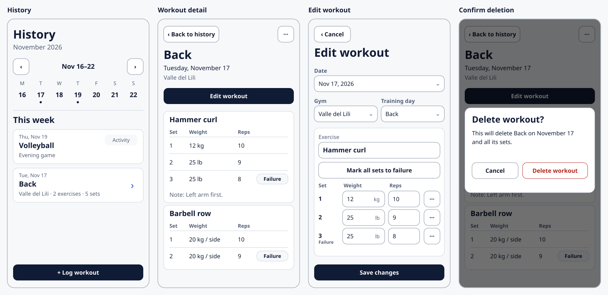
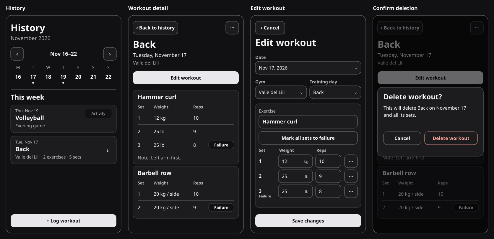

# Post-M3 design boards

| File | Purpose |
|---|---|
| [saved-workout-light.svg](saved-workout-light.svg) | History, workout detail, edit and delete confirmation in the approved light theme |
| [saved-workout-dark.svg](saved-workout-dark.svg) | Same states in the approved monochrome dark theme |

The four frames are independent phone-width references with sample data. The editor is scrollable,
and its footer reserves room for the final row and the device safe area. Build semantic UI using the
[M3 palette and geometry](../m3-pages/README.md) and the [existing set-details states](../m3-pages/README.md#set-details).
The boards use a 390 px frame width and 44 px minimum control dimensions. Validate usable targets and
focus in implementation, including Escape, Cancel, keyboard access and scroll with 16 px inputs.

| Meaning | English | Spanish |
|---|---|---|
| Return to list | Back to history | Volver al historial |
| Edit action and title | Edit workout | Editar entrenamiento |
| Save edit | Save changes | Guardar cambios |
| Discard heading | Discard changes? | ¿Descartar los cambios? |
| Keep draft | Keep editing | Seguir editando |
| Drop draft | Discard changes | Descartar cambios |
| Overflow accessible name | Workout options | Opciones del entrenamiento |
| Delete action | Delete workout | Eliminar entrenamiento |
| Confirm heading | Delete workout? | ¿Eliminar el entrenamiento? |
| Confirm context | This will delete {workout} on {date} and all its sets. | Se eliminarán {workout} del {date} y todas sus series. |
| Cancel | Cancel | Cancelar |
| Save success | Changes saved. | Cambios guardados. |
| Delete success | Workout deleted. | Entrenamiento eliminado. |

Longer Spanish labels can wrap. Date and number examples follow the current locale in the app.
Use text and iconography with any color for pending, failure and success. Localize retry feedback
and accessible names, including row controls. The English frames specify placement and hierarchy.
See [decision 0008](../../decisions/0008-saved-workout-detail.md) for behavior and ownership.
