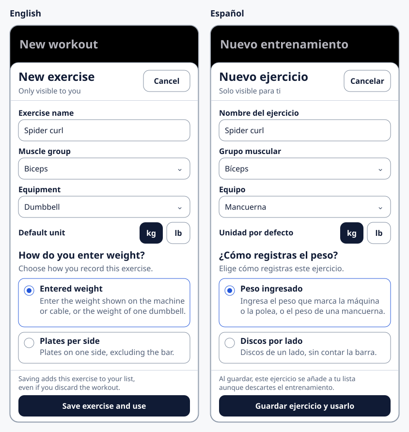
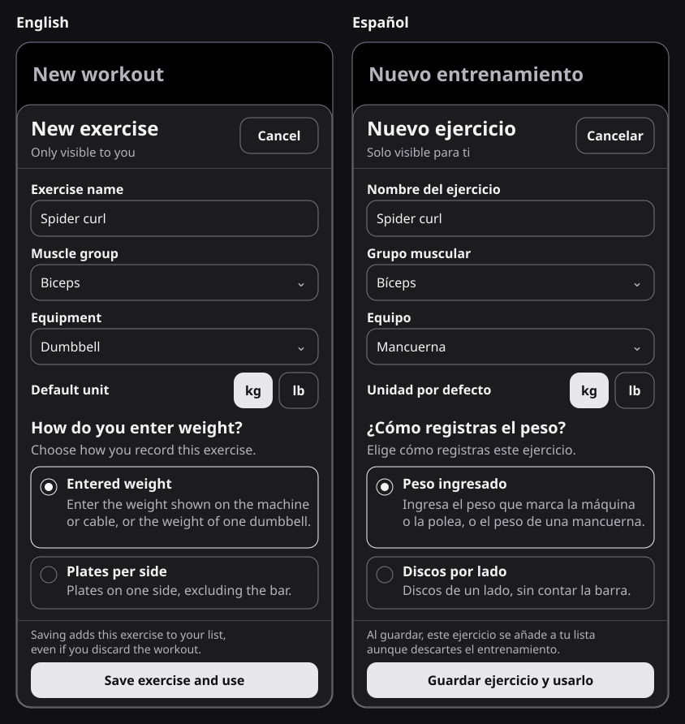

# Dumbbell weight-entry wording

| File | Purpose |
|---|---|
| [dumbbell-weight-light.svg](dumbbell-weight-light.svg) | English and Spanish setup sheets in the light theme |
| [dumbbell-weight-dark.svg](dumbbell-weight-dark.svg) | English and Spanish setup sheets in the monochrome dark theme |

Both frames show a worked example after selecting Entered weight. A newly opened sheet
starts with neither load mode selected, even after choosing Dumbbell equipment. The form
fields and footer are shown for context. Follow the [M3 setup reference](../../m3-pages/README.md#custom-exercise-setup)
for the persistence, scrolling, focus and bar-field behavior. Use the existing palette and
keep the whole radio card tappable, with at least a 44 × 44 px target.

| Meaning | English | Spanish |
|---|---|---|
| Updated option | Entered weight | Peso ingresado |
| Updated help | Enter the weight shown on the machine or cable, or the weight of one dumbbell. | Ingresa el peso que marca la máquina o la polea, o el peso de una mancuerna. |

The change applies to the label and explanation for `total`. The example includes the
other radio for context. Use its existing localized strings. See
[decision 0010](../../../decisions/0010-dumbbell-weight-copy.md) for the implementation handoff.
