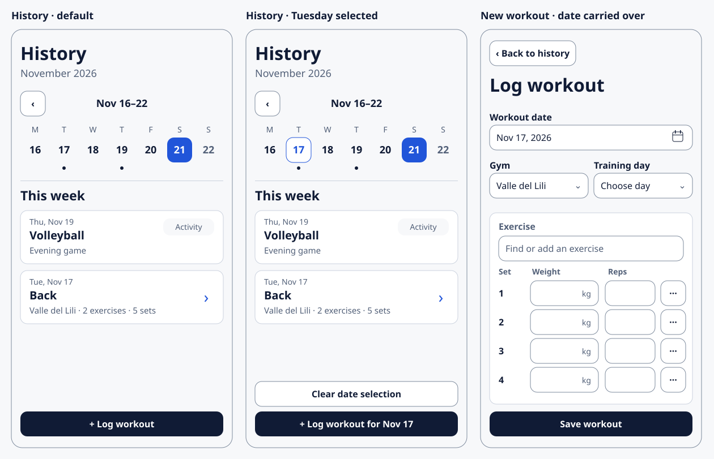
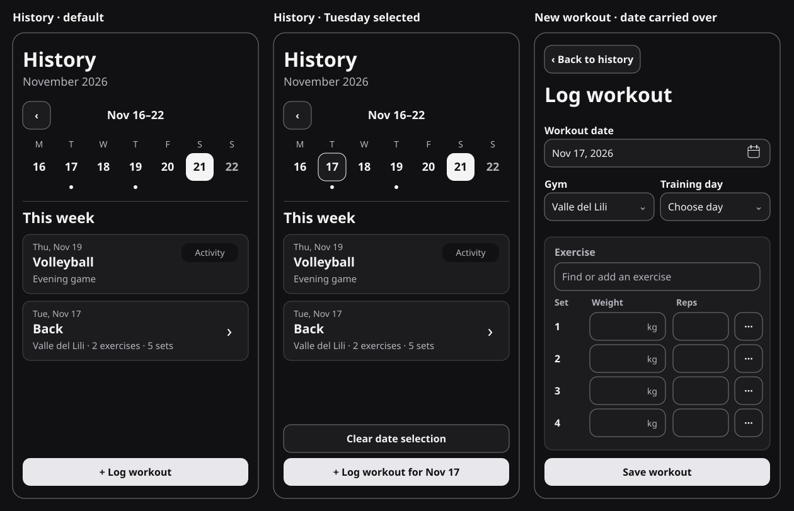

# Past-day workout boards

| File | Purpose |
|---|---|
| [past-day-light.svg](past-day-light.svg) | Default history, selected day and dated entry in light theme |
| [past-day-dark.svg](past-day-dark.svg) | The same three states in monochrome dark theme |

Example context is Saturday, November 21. Tuesday has an entry and is selected in the
second frame. Today has a filled marker, selection has an outline, and dots mark entries.
Sunday is a static future date. Wednesday illustrates an empty past day that can be selected.
The third frame shows a new form with Tuesday carried into its editable date control.

Use the [approved M3 theme and geometry](../../m3-pages/README.md). Day controls are
44 × 44 px or larger. At narrow widths let the history outer padding accommodate seven
44 px columns, and let long Spanish labels wrap without shrinking touch targets.
The boards show English examples. The live UI formats dates and status strings by locale.

| Meaning | English | Spanish |
|---|---|---|
| Entry heading | Log workout | Registrar entrenamiento |
| Field label | Workout date | Fecha del entrenamiento |
| Dated action | Log workout for {date} | Registrar entrenamiento del {date} |
| Clear action | Clear date selection | Quitar selección de fecha |
| Existing draft heading | Resume your workout draft? | ¿Retomar el borrador del entrenamiento? |
| Keep draft and date | Resume draft | Retomar borrador |
| Discard and start | Discard draft and start new workout | Descartar borrador e iniciar otro entrenamiento |

See [decision 0009](../../../decisions/0009-past-day-workout.md) for the full behavior and handoff.
